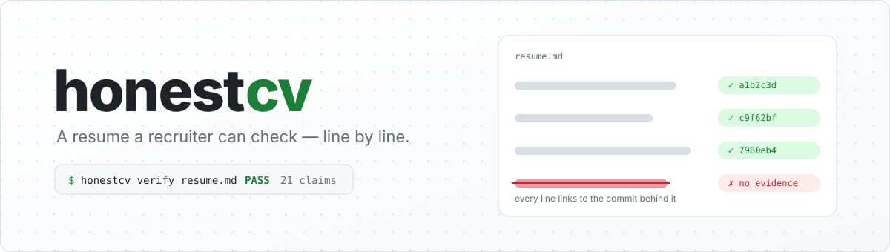
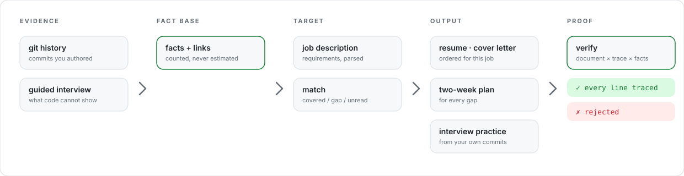
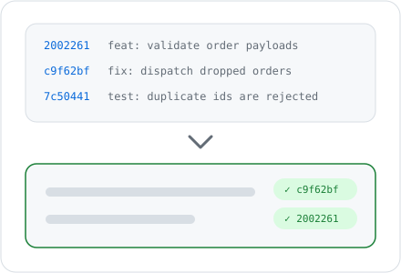
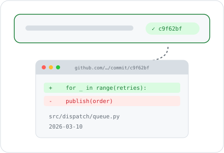
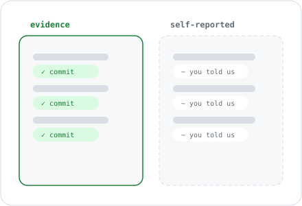
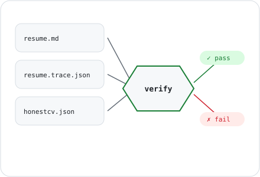
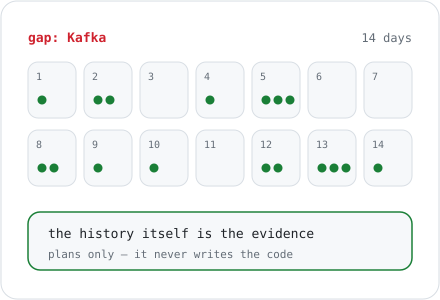
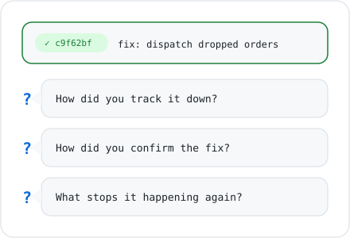

<div align="center">

<picture>
  <source media="(prefers-color-scheme: dark)" srcset="assets/banner-dark.svg">
  
</picture>

## honestcv: Show the Evidence You Already Have

[](https://github.com/JayLZhou/honestcv/actions/workflows/ci.yml)
[](https://www.python.org/)
[](pyproject.toml)
[](#optional-polish)
[](LICENSE)
[](README.zh.md)

### ✨ Every line of your resume links to the commit behind it — and a verifier proves it. ✨

</div>

<a id="why"></a>

## 🎯 Why honestcv?

You are good enough for the job and you cannot show it.

You came out of a bootcamp, or taught yourself. Your GitHub has three practice projects that
look exactly like your classmates'. There is no recognisable company name on your CV. And the
person reviewing it starts from the assumption that a junior's portfolio was generated.

That is not a writing problem. It is an **evidence** problem — and no amount of better adjectives
fixes it.

honestcv reads the evidence you already produced and makes it legible:

- **What you actually did** — pulled from your commits, not from a README's marketing copy.
- **Proof that you did it** — every bullet carries a link a reviewer can click.
- **What you cannot yet show** — stated as a gap, answered with a two-week project, never papered over.

**The rule the whole tool obeys**: **translate and reorder facts. Never add one.**

### 🔌 Works with what you already have

| You bring | honestcv uses it for |
| :-- | :-- |
| any **git** repository — GitHub, GitLab, or purely local | mining facts; public hosts also get clickable evidence links |
| a **job description** pasted into a text file | per-requirement coverage, ordering, and the gap list |
| **what only you know** (first version failed, you were alone on it) | a guided interview, stored and rendered as *self-reported* |
| *(optional)* an **Anthropic API key** | nicer wording — re-verified, discarded if it drifts |

Nothing else. No account, no upload, no required dependency, no model in the loop.

<div align="center">
<picture>
  <source media="(prefers-color-scheme: dark)" srcset="assets/pipeline-dark.svg">
  
</picture>
</div>

<a id="watch"></a>

## 👀 Watch It Reject a Lie

<div align="center">
  
</div>

<div align="center"><sub>Real output, copied from <code>examples/demo.sh</code>. Run it yourself in 20 seconds.</sub></div>

That last exit code is the product. Everything else in this repo is how it gets there.

<a id="features"></a>

## ✨ Key Features

### 🧾 A fact base, not an upload form

- 🔍 **Mined, not typed** — features, fixes, refactors, tests, dependencies **you** added, infrastructure **you** set up, issues you closed.
- 🔢 **Counted, never estimated** — if a number is in a bullet, something counted it.
- 🔗 **Linked** — every fact carries the commits behind it, so a reviewer is one click from the source.
- 🏷 **Honest about its sources** — what you told us is labelled self-reported, every single time.

<table>
  <tr>
    <td width="33.33%" align="center">
      <picture><source media="(prefers-color-scheme: dark)" srcset="assets/card-mine-dark.svg"></picture>
    </td>
    <td width="33.33%" align="center">
      <picture><source media="(prefers-color-scheme: dark)" srcset="assets/card-links-dark.svg"></picture>
    </td>
    <td width="33.33%" align="center">
      <picture><source media="(prefers-color-scheme: dark)" srcset="assets/card-self-report-dark.svg"></picture>
    </td>
  </tr>
  <tr>
    <td width="33.33%" valign="top">
      <p align="center"><strong>🔍 Your commits become facts</strong></p>
      <p>Grouped by area and intent, with the most informative commit subject kept as written — never a synthesis of what you "probably" meant.</p>
    </td>
    <td width="33.33%" valign="top">
      <p align="center"><strong>🔗 One click to the source</strong></p>
      <p>Each bullet ends in the commits behind it. A reviewer who doubts you can open the diff instead of guessing.</p>
    </td>
    <td width="33.33%" valign="top">
      <p align="center"><strong>🏷 Self-reported stays self-reported</strong></p>
      <p>Answers only you can give are kept, used and rendered — in their own section, never dressed up as verifiable.</p>
    </td>
  </tr>
</table>

### 🔒 Proof, not promises

- ✅ **Every document ships with a trace** — which fact, which evidence, for every line.
- 🚫 **Six checks** stand between you and a claim you cannot defend.
- 🧪 **Exit codes** — `honestcv verify` fails loudly, so it works in CI as well as in a terminal.
- 🛠 **A gap gets a project** — two weeks of evenings, day by day, not an extra line in a skills list.

<table>
  <tr>
    <td width="33.33%" align="center">
      <picture><source media="(prefers-color-scheme: dark)" srcset="assets/card-verify-dark.svg"></picture>
    </td>
    <td width="33.33%" align="center">
      <picture><source media="(prefers-color-scheme: dark)" srcset="assets/card-plan-dark.svg"></picture>
    </td>
    <td width="33.33%" align="center">
      <picture><source media="(prefers-color-scheme: dark)" srcset="assets/card-practice-dark.svg"></picture>
    </td>
  </tr>
  <tr>
    <td width="33.33%" valign="top">
      <p align="center"><strong>✅ Verify reconciles three things</strong></p>
      <p>Document × trace × fact base. An edited line, an unbacked number, a skill the evidence does not show — each one fails, by name.</p>
    </td>
    <td width="33.33%" valign="top">
      <p align="center"><strong>🛠 A gap becomes two weeks</strong></p>
      <p>It plans the project and refuses to write it. The commit history spread across those evenings is itself the evidence.</p>
    </td>
    <td width="33.33%" valign="top">
      <p align="center"><strong>❓ Practice on your own work</strong></p>
      <p>Questions generated from your commits — including the one every junior now gets: "how do I know you did not generate this?"</p>
    </td>
  </tr>
</table>

<a id="toc"></a>

## 📋 Table of Contents

- [🎯 Why honestcv?](#why)
- [👀 Watch It Reject a Lie](#watch)
- [✨ Key Features](#features)
- [🚀 Quick Start](#quick-start)
- [🧩 How It Works](#how-it-works)
  - [Challenge 1: The reviewer assumes you generated it](#challenge-1)
  - [Challenge 2: Resume tools invent what they do not know](#challenge-2)
  - [Challenge 3: A gap cannot be worded away](#challenge-3)
- [📊 honestcv in Action](#in-action)
- [🧭 Commands](#commands)
- [📖 Code Structure](#code-structure)
- [⚠️ What It Cannot Do](#limits)
- [🛠 Development](#development)
- [🔗 Related Projects](#related)

<a id="quick-start"></a>

## 🚀 Quick Start

### ① Install

```bash
git clone https://github.com/JayLZhou/honestcv && cd honestcv
pip install -e .
```

### ② Turn a repository into facts

```bash
honestcv init --name "Your Name" --email you@example.com
honestcv --lang en mine ~/code/your-project
honestcv --lang en audit ~/code/your-project     # how legible is this history to a reviewer?
```

### ③ Aim at one job

```bash
honestcv --lang en match  --jd jd.txt             # covered / gap / could-not-read, per requirement
honestcv --lang en resume --jd jd.txt -o resume.md
honestcv --lang en plan   --jd jd.txt -o plan.md  # two-week projects for what is missing
```

### ④ Prove it

```bash
honestcv --lang en verify resume.md               # exits non-zero if any line is unbacked
```

<details>
<summary><b>No repository of your own to try it on?</b></summary>

<br>

```bash
bash examples/demo.sh
```

It builds a fixture repo that looks like three weeks of evenings — features, a bug found later
and fixed, tests written along the way, one dependency added — runs the whole pipeline, then
appends one invented line to the finished resume and lets the verifier catch it. No network, no
API key.

</details>

<a id="how-it-works"></a>

## 🧩 How It Works

<a id="challenge-1"></a>

### 🧩 Challenge 1: The reviewer assumes you generated it

**The problem.** Junior portfolios now arrive under suspicion. A reviewer cannot tell your three
weeks of evenings from a repository a model produced in an afternoon, so they discount both.
Protesting that it is genuine does not help; everyone says that.

**✅ The solution: make the real work legible, and never claim what cannot be checked.**

Facts are mined from the history, so a bullet points at commits rather than at adjectives. On top
of that, `honestcv audit` scores how *legible* a history is — time span, days with commits,
largest-commit share, whether you went back and changed your own code, whether anything was ever
fixed — and names the one pattern reviewers react to hardest:

```console
$ honestcv --lang en audit ~/code/dumped-project
**Score**: 6/100 (1 commit)

## Clear problems
- The first commit contains most of the project. A reviewer reads this as code that
  arrived from somewhere else.
```

Every suggestion it then gives is about leaving traces of work you actually do. The report says,
in its own output, that it cannot prove authorship and that a low score is not an accusation —
because that is true, and a tool that overclaims here would be the same problem wearing a lab coat.

<a id="challenge-2"></a>

### 🧩 Challenge 2: Resume tools invent what they do not know

**The problem.** Ask a model to "improve this bullet" and you get *"optimised the pipeline,
improving throughput by 40%"*. Nobody measured 40%. The candidate finds out in the interview,
in front of the person who can give them the job.

**✅ The solution: make invention structurally impossible, then check anyway.**

A fact is not a sentence. It is a template plus a payload that came out of the evidence:

```json
{
  "template": "bugfix_work",
  "payload": { "repo": "demo/orders", "area": "src/dispatch", "commits": 2,
               "subject": "dispatch dropped orders when the queue was slow" },
  "skills": ["Python"],
  "evidence": [{ "kind": "commit", "ref": "c9f62bf",
                 "url": "https://github.com/demo/orders/commit/c9f62bf…" }]
}
```

Renderers choose facts, order them and pick a language. They cannot write a sentence, because the
sentences live in `data/templates.json` and the only values they may interpolate are the payload's.
Switching language swaps the template, never the payload — a test asserts that the English and
Chinese resumes contain exactly the same numbers.

Then every document ships with a trace, and `honestcv verify` reconciles it:

| Check | Failure |
| :-- | :-- |
| Is this line in the trace? | ✗ `untraced_claim` — added or edited after generation |
| Does the fact it names still exist? | ✗ `unknown_fact` |
| Does every number come from the evidence? | ✗ `unbacked_number` — *"by 40%"* dies here |
| Does the fact demonstrate the skills named? | ✗ `unbacked_skill` |
| Is there a clickable link? | ! `missing_link` |
| Any *"expert"*, *"world-class"*, *"精通"*? | ! `unverifiable_language` |

`--strict` turns the warnings into failures. The same checks run on the optional model output, so
a rewrite that drifts is discarded and the plain wording is kept.

<a id="challenge-3"></a>

### 🧩 Challenge 3: A gap cannot be worded away

**The problem.** The JD asks for Kafka and your history has none. Every resume tool's answer is to
add "Kafka" to a skills list. That survives the keyword filter and dies in the first technical
question.

**✅ The solution: two weeks of evenings, planned but not written.**

```markdown
## Two-week plan to close the gap: Kafka

Project: Order events pipeline with replay
Why this proves it: Anyone can run a Kafka tutorial. Handling a consumer crash mid-batch,
                    duplicate delivery and offset replay is what separates "used Kafka"
                    from "understands Kafka".
Out of scope:       No UI. No second service. One topic, one consumer group, one failure
                    mode handled well.

| Days  | Focus                                              | Deliverable                                   |
| 4-7   | Manual offset commits; kill the consumer mid-batch | FAILURE_NOTES.md listing what got redelivered |
| 8-10  | Idempotent consumer with a processed-ids table     | a test that replays the same message twice    |
```

Eight hand-written blueprints (Kafka, Kubernetes, Redis, PostgreSQL, gRPC, React, CI/CD,
OpenTelemetry) plus a generic one. Each ends with the questions you must be able to answer
afterwards — and the plan never includes the code, because an interviewer asks what you were
thinking while you wrote it and nobody can have that experience for you.

<a id="in-action"></a>

## 📊 honestcv in Action

Run against the fixture repository in [`examples/`](examples/) — 20 commits spread over 22 days,
the shape of a real side project. Every number below is reproducible with `bash examples/demo.sh`:

| Stage | Result |
| :-- | :-- |
| `mine` | **13 facts** from 20 commits; **9 skills** with evidence behind them |
| `audit` | **94/100** legibility, no problem flags |
| `match` (backend JD) | **100%** must-have coverage, 1 nice-to-have gap (Kubernetes) |
| `resume` | **21 claims**, every one traced — `PASS (0 errors, 0 warnings)` |
| `plan` | a 14-day Kafka-style project for the gap, day by day |
| one invented line appended by hand | `FAIL … ✗ untraced_claim`, **exit code 1** |

And on a repository that arrived as a single commit:

| Signal | Observed | Score |
| :-- | :-- | --: |
| Time span | 0 days | 0% |
| Days with commits | 1 day | 8% |
| Commit count | 1 commit | 2% |
| Largest commit share | 100% of all changed lines | 0% |
| Revisited own files | 0% of commits | 0% |
| Fixes and refactors | 0% of commits | 0% |
| **Total** | | **6/100** |

> [!NOTE]
> That 6 is not an accusation, and the tool says so in its own report. It is a list of things a
> reviewer currently cannot see — each one fixable by doing real work and committing it as you go.

<a id="commands"></a>

## 🧭 Commands

| Command | What it does |
| :-- | :-- |
| `honestcv init` | start a fact base |
| `honestcv mine <repo>` | git history → facts (re-mining replaces, never duplicates) |
| `honestcv audit <repo>` | evidence-strength audit, `--json` for scripts |
| `honestcv questions [--jd]` | what code cannot answer; `--template` writes a blank answer sheet |
| `honestcv interview [--answers f]` | record answers as self-reported facts, or ask them in the terminal |
| `honestcv facts [--skill X]` | what the fact base holds |
| `honestcv match --jd jd.txt` | per requirement: covered / gap / could-not-read |
| `honestcv resume --jd jd.txt` | tailored resume |
| `honestcv letter --jd jd.txt` | cover letter — what it cannot know stays a `[TODO]` |
| `honestcv plan --jd jd.txt` | two-week projects for the gaps |
| `honestcv practice [--jd]` | interview questions from your own work |
| `honestcv verify <doc>` | reconcile document, trace and facts; `--strict` fails on warnings |

Global flags: `--lang en|zh` (default `zh`), `-f/--file` (fact base, default `honestcv.json`).

<a id="optional-polish"></a>

<details>
<summary><b>Optional: let Claude polish the wording</b></summary>

<br>

```bash
pip install -e ".[llm]"
export ANTHROPIC_API_KEY=...
honestcv --lang en resume --jd jd.txt --polish
```

The model receives **one sentence plus the numbers and technologies that sentence is allowed to
use**. It never sees the evidence links, so it cannot invent one. Every sentence it returns goes
through the same rules as the renderer — a new number, a dropped number, a new skill or an
attempted link means the rewrite is discarded, the original is kept, and the reason is printed to
stderr.

No `anthropic` package, no API key, or a failed call: you still get your resume, in plainer words.
**Nothing in this tool requires a model.**

</details>

<a id="code-structure"></a>

## 📖 Code Structure

> **Legend**: 📥 evidence in | 🧠 core model | 📤 documents out | 🔒 the invariant | 🎨 artwork

```text
honestcv/
├── src/honestcv/
│   ├── models.py            🧠 Evidence, Fact, FactBase — the data model everything rests on
│   ├── taxonomy.py          🧠 paths, dependencies and free text → canonical skills
│   ├── i18n.py              🧠 templates per language; swapping one never touches a payload
│   ├── grounding.py         🔒 Trace + verify: the six checks, run after every render
│   ├── mining/
│   │   ├── git_miner.py     📥 commits → facts, with every number counted
│   │   └── authenticity.py  📥 evidence-strength audit, and what it refuses to claim
│   ├── jd.py                📥 job description → requirements (must / nice / unreadable)
│   ├── matcher.py           🧠 covered / gap / unread, kept strictly apart
│   ├── interview.py         📥 what code cannot show, stored as self-reported
│   ├── render/
│   │   ├── resume.py        📤 tailored resume + its trace
│   │   ├── cover_letter.py  📤 letter whose unknowns stay [TODO]
│   │   └── project_plan.py  📤 gap → two-week project
│   ├── practice.py          📤 interview questions from the person's own facts
│   ├── llm.py               📤 optional polish, re-verified and discarded if it drifts
│   ├── cli.py               🧭 the command line
│   └── data/                skills.json · templates.json · gap_projects.json
├── tests/                   92 tests — no network, no API key
├── examples/                fixture repo builder, two JDs, the end-to-end demo
└── assets/make_assets.py    🎨 generates every image in this README
```

~3,100 lines of Python, zero required dependencies.

<a id="limits"></a>

## ⚠️ What It Cannot Do

> [!WARNING]
> Being honest about this matters more than being useful.

- **It cannot fix discrimination.** If the problem is that employers will not interview you at all,
  no resume solves it. The leverage there is matching with employers who will — not wording.
- **It cannot create junior roles.** If the roles are disappearing, a better resume only ranks you
  higher in a smaller pool. This helps people who are good enough but cannot show it; it does
  nothing about jobs that are not posted.
- **It cannot prove who wrote the code.** `audit` measures legibility, not authorship. A low score
  is not an accusation.
- **It will not secretly translate your commits.** Whatever language your commit messages are in is
  the language quoted in your resume, unless you turn on `--polish`.

<a id="development"></a>

## 🛠 Development

```bash
pip install -e ".[dev]"
pytest -q                      # 92 tests, no network, no API key
bash examples/demo.sh          # the end-to-end path, also run in CI
python3 assets/make_assets.py  # regenerate every image above
```

CI runs the suite and the demo on 3.11 / 3.12 / 3.13, and on 3.9 in a container — the runner images
no longer ship 3.9, and a claim nobody tests is exactly what this project is against.

The two most useful places to contribute:

- **[`src/honestcv/data/skills.json`](src/honestcv/data/skills.json)** — the skill vocabulary:
  aliases, file extensions, dependency names, path signatures.
- **[`src/honestcv/data/gap_projects.json`](src/honestcv/data/gap_projects.json)** — two-week
  blueprints. One rule: it must be something a single person can genuinely finish in two weeks of
  evenings, and talk about for ten minutes in an interview.

See **[docs/design.md](docs/design.md)** for why a fact is a template plus a payload, and how the
trace survives contact with a human editing their own resume.

<a id="related"></a>

## 🔗 Related Projects

**Resume tooling** — all good at what they do; none of them tries to prove the content is true.

- **[Resume-Matcher](https://github.com/srbhr/Resume-Matcher)** — matches a resume against a job
  description and suggests improvements. honestcv starts one step earlier: it builds the content
  from your commits, and ends one step later: it verifies it.
- **[Reactive Resume](https://github.com/reactive-resume/reactive-resume)** — a privacy-first
  resume builder with beautiful output. You bring the content; honestcv is about where the content
  comes from.
- **[RenderCV](https://github.com/rendercv/rendercv)** — resume as YAML, typeset to PDF. A natural
  downstream of a fact base: honestcv decides *what* is true, RenderCV decides how it looks.
- **[Awesome-CV](https://github.com/posquit0/Awesome-CV)** — the LaTeX template many engineers use.

**Why the difference matters**: tools that generate a GitHub history help people fake evidence.
honestcv is the opposite bet — that most junior candidates are telling the truth and simply cannot
prove it.

<br>

<div align="center">
<sub><b>MIT</b> · Built for people who are good enough and cannot show it yet.</sub>
</div>
