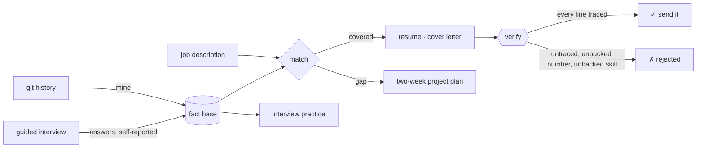

<div align="center">

# honestcv

### Turn the evidence you already have into a resume a recruiter can check — line by line.

[](https://github.com/JayLZhou/honestcv/actions/workflows/ci.yml)
[](https://www.python.org/)
[](pyproject.toml)
[](LICENSE)

**[Quickstart](#quickstart)** · **[How it works](#how-it-works)** · **[The verifier](#2-the-verifier-the-part-that-matters)** · **[Commands](#commands)** · **[Design notes](docs/design.md)** · **[中文](README.zh.md)**

</div>

---

## Who this is for

You are good enough for the job and you cannot show it.

You came out of a bootcamp, or taught yourself. Your GitHub has three practice projects that
look exactly like your classmates'. There is no recognisable company name on your CV. And the
person reviewing it now starts from the assumption that a junior's portfolio was generated by
a model.

That is not a writing problem. It is an **evidence** problem.

> Tools that generate a GitHub history help you fake evidence.
> **honestcv helps you show the evidence you already have — and prove it is real.**

---

## Quickstart

```bash
pip install -e .

honestcv init --name "Your Name" --email you@example.com
honestcv --lang en mine ~/code/your-project         # git history  →  fact base
honestcv --lang en match  --jd jd.txt               # backed / gap / unreadable, per requirement
honestcv --lang en resume --jd jd.txt -o resume.md  # tailored resume, every line linked
honestcv --lang en verify resume.md                 # prove every line still stands
```

No repository of your own to try it on? The demo builds one:

```bash
bash examples/demo.sh
```

It creates a fixture repo that looks like three weeks of evenings, runs the whole pipeline,
then appends one invented line to the finished resume and lets the verifier catch it.

---

## The 30-second version

```console
$ honestcv --lang en mine orders --author demo@example.com
Mined 13 facts from orders (author: demo@example.com), 13 new.
Skills with evidence: Python, REST API, CI/CD, Docker, FastAPI, Kafka, PostgreSQL, Redis, Testing

$ honestcv --lang en match --jd jd-backend-en.txt
**Must-have coverage**: 100% (backed by evidence)

## Must have
- ✅ Working knowledge of PostgreSQL, including reading a query plan
    - Introduced PostgreSQL into demo/orders and shipped the integration (visible in requirements.txt) [09e77de]
- ✅ You have used Docker to run services locally
    - Set up Docker for demo/orders (first appears in Dockerfile) [7980eb4]
- ✅ Experience with Kafka or another message queue
    - Introduced Kafka into demo/orders and shipped the integration (visible in requirements.txt) [c7f2ca4]

## Nice to have
- ❌ Kubernetes
    - missing: Kubernetes

$ honestcv --lang en resume --jd jd-backend-en.txt -o resume.md
Wrote resume.md (trace: resume.trace.json)
resume.md: PASS (21 claims checked, 0 errors, 0 warnings)
  Every claim traces back to evidence.
```

Now somebody — you, in a hurry, at 1am — adds a line that sounds better than the truth:

```console
$ echo '- Led a team of 12 engineers and cut p99 latency by 90%' >> resume.md
$ honestcv --lang en verify resume.md
resume.md: FAIL (22 claims checked, 1 errors, 0 warnings)
  ✗ [untraced_claim] - Led a team of 12 engineers and cut p99 latency by 90%
      This line is not in the trace: it was added or edited after generation, so nothing backs it.
$ echo $?
1
```

That failure is the product. Everything else is how it gets there.

---

## How it works



Everything downstream comes from one fact base. A fact is not a sentence — it is a template
plus a payload that came out of the evidence:

<details>
<summary><b>What a fact actually looks like</b></summary>

```json
{
  "template": "bugfix_work",
  "payload": {
    "repo": "demo/orders",
    "area": "src/dispatch",
    "commits": 2,
    "subject": "dispatch dropped orders when the queue was slow"
  },
  "skills": ["Python"],
  "kind": "bugfix",
  "period": ["2026-03-10", "2026-03-16"],
  "evidence": [
    { "kind": "commit", "ref": "c9f62bf", "repo": "demo/orders",
      "url": "https://github.com/demo/orders/commit/c9f62bf…", "date": "2026-03-10" }
  ]
}
```

Switching language swaps the **template**, never the payload. That turns *"translate and
reorder, never add"* from a promise into a property of the data model — and a test holds it
down: the same fact base rendered in English and Chinese must contain exactly the same
numbers.

</details>

---

## Four things that make it different

### 1. A fact base, not an upload form

| Source | Where it comes from | Strength |
| :-- | :-- | :-- |
| `git` | your own commits: features, fixes, refactors, tests, dependencies **you** added, infrastructure **you** set up, issues you closed | public links, anyone can check |
| `interview` | guided questions about what code cannot show — were you alone on it? what broke in the first version? | always rendered as **self-reported**, never dressed up |

Every number in a fact was **counted**, never estimated. Re-mining a repository replaces its
facts instead of piling up duplicates.

### 2. The verifier (the part that matters)

Each rendered document ships with a sidecar trace recording which fact and which evidence
produced every single line. `honestcv verify` reconciles document, trace and fact base:

| Check | Failure |
| :-- | :-- |
| Is this line in the trace? | ✗ `untraced_claim` — added or edited after generation |
| Does the fact it names still exist? | ✗ `unknown_fact` |
| Does every number come from the evidence? | ✗ `unbacked_number` — "cut latency by 90%" dies here |
| Does the fact actually demonstrate the skills named? | ✗ `unbacked_skill` |
| Is there a clickable link? | ! `missing_link` |
| Any "expert", "world-class", "精通"? | ! `unverifiable_language` |

`--strict` turns the warnings into failures. The exit code is CI-friendly, because the point
is not to generate a resume — it is to be able to **prove you did not embellish one**.

### 3. A gap gets a project, not a bullet

The JD asks for Kafka and your history has none. honestcv will not quietly add Kafka to a
skills list. It gives you two weeks:

```markdown
## Two-week plan to close the gap: Kafka

Project: Order events pipeline with replay
Why this proves it: Anyone can run a Kafka tutorial. Handling a consumer crash mid-batch,
                    duplicate delivery and offset replay is what separates "used Kafka"
                    from "understands Kafka".
Out of scope:       No UI. No second service. One topic, one consumer group, one failure
                    mode handled well.

| Days  | Focus                                            | Deliverable                              |
| 4-7   | Manual offset commits; kill the consumer mid-batch | FAILURE_NOTES.md listing what got redelivered |
| 8-10  | Idempotent consumer with a processed-ids table   | a test that replays the same message twice |
```

Plans only — it never writes the code. An interviewer asks what you were thinking while you
wrote it, and nobody can have that experience for you. A commit history spread across two
weeks of evenings is itself the evidence that you did.

Eight hand-written blueprints (Kafka, Kubernetes, Redis, PostgreSQL, gRPC, React, CI/CD,
OpenTelemetry) plus a generic one for everything else.

### 4. An evidence-strength audit that admits what it cannot know

```console
$ honestcv --lang en audit ~/code/your-project
# Evidence strength audit
**Score**: 94/100 (20 commits)

> This score measures how legible your work is to a reviewer, not whether you cheated.
> It cannot prove authorship, and a low score is not an accusation.

| Signal                 | Observed                   | Score |
| Time span              | 22 days                    |  100% |
| Days with commits      | 19 days                    |  100% |
| Largest commit share   | 9% of all changed lines    |   91% |
| Revisited own files    | 70% of commits             |  100% |
| Fixes and refactors    | 40% of commits             |  100% |
```

A project dropped in as one commit is named for what it is (`initial_dump`). Every suggestion
it makes is about **leaving traces of real work** — none of them is about rewriting history.

<details>
<summary><b>Bonus: interview practice from your own commits</b></summary>

The first question in a junior technical interview is "tell me about this project". A generic
question bank does not help with that one.

```markdown
- Fixed 2 defects in src/dispatch of demo/orders: dispatch dropped orders when the queue was slow [c9f62bf]
- *Re-read before answering*: [c9f62bf] [019a21d]

- ❓ Walk me through this bug. How did you track it down?
- ❓ How did you confirm it was actually fixed rather than hidden?
- ❓ How did this get introduced, and what stops it happening again?
- ❓ The interviewer will assume your project was generated. How do you change their mind?
     (Hint: talk about what went wrong. Generated code has no scars.)
```

The answers are always left blank. An answer you did not write is one you cannot defend.

</details>

---

## Commands

| Command | What it does |
| :-- | :-- |
| `honestcv init` | start a fact base |
| `honestcv mine <repo>` | git history → facts (re-mining replaces, never duplicates) |
| `honestcv audit <repo>` | evidence-strength audit, with `--json` for scripts |
| `honestcv questions [--jd]` | what code cannot answer; `--template` writes a blank answer sheet |
| `honestcv interview [--answers f]` | record answers as self-reported facts, or ask them in the terminal |
| `honestcv facts [--skill X]` | what the fact base holds |
| `honestcv match --jd jd.txt` | per requirement: covered / gap / could-not-read |
| `honestcv resume --jd jd.txt` | tailored resume |
| `honestcv letter --jd jd.txt` | cover letter — what it cannot know stays a `[TODO]` |
| `honestcv plan --jd jd.txt` | two-week projects for the gaps |
| `honestcv practice [--jd]` | interview questions from your own work |
| `honestcv verify <doc>` | reconcile document, trace and facts; `--strict` fails on warnings |

Global flags: `--lang en|zh` (default `zh`), `-f/--file` (fact base, default `honestcv.json`).

<details>
<summary><b>Optional: let Claude polish the wording</b></summary>

```bash
pip install -e ".[llm]"
export ANTHROPIC_API_KEY=...
honestcv --lang en resume --jd jd.txt --polish
```

The model receives **one sentence plus the numbers and technologies that sentence is allowed
to use**. It never sees the evidence links, so it cannot invent one. Every sentence it returns
goes through the same rules as the renderer — a new number, a dropped number, a new skill or
an attempted link means the rewrite is discarded, the original is kept, and the reason is
printed to stderr.

No `anthropic` package, no API key, or a failed call: you still get your resume, in plainer
words. **Nothing in this tool requires a model.**

</details>

---

## What it cannot do

Being honest about this matters more than being useful:

- **It cannot fix discrimination.** If the problem is that employers will not interview you at
  all, no resume solves it. The leverage there is matching with employers who will — not
  wording.
- **It cannot create junior roles.** If the roles are disappearing, a better resume only ranks
  you higher in a smaller pool. This helps people who are good enough but cannot show it; it
  does nothing about jobs that are not posted.
- **It cannot prove who wrote the code.** `audit` measures legibility, not authorship. A low
  score is not an accusation.
- **It will not secretly translate your commits.** Whatever language your commit messages are
  in is the language quoted in your resume, unless you turn on `--polish`.

---

## Development

```bash
pip install -e ".[dev]"
pytest -q              # 91 tests, no network, no API key
bash examples/demo.sh  # the end-to-end path, also run in CI
```

Zero required dependencies, standard library only, Python 3.9+. CI runs the suite and the demo
on 3.11 / 3.12 / 3.13, and on 3.9 in a container — the runner images no longer ship 3.9, and a
claim nobody tests is exactly what this project is against.

The two most useful places to contribute:

- **[`src/honestcv/data/skills.json`](src/honestcv/data/skills.json)** — the skill vocabulary:
  aliases, file extensions, dependency names, path signatures.
- **[`src/honestcv/data/gap_projects.json`](src/honestcv/data/gap_projects.json)** — two-week
  blueprints. One rule when adding one: it must be something a single person can genuinely
  finish in two weeks of evenings, and talk about for ten minutes in an interview.

See **[docs/design.md](docs/design.md)** for why a fact is a template plus a payload, and how
the trace survives contact with a human editing their own resume.

---

<div align="center">
<sub>MIT · Built for people who are good enough and cannot show it yet.</sub>
</div>
