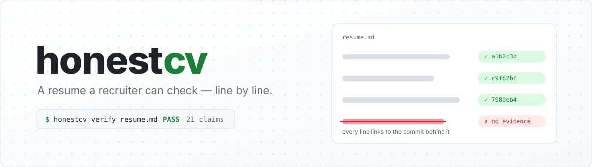
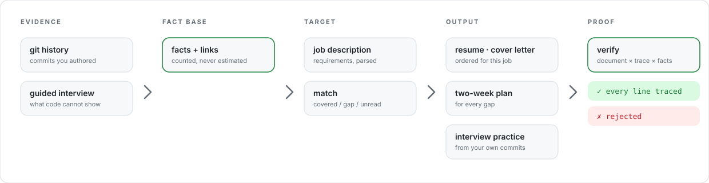

<div align="center">

<picture>
  <source media="(prefers-color-scheme: dark)" srcset="assets/banner-dark.svg">
  
</picture>

<br><br>

[](https://github.com/JayLZhou/honestcv/actions/workflows/ci.yml)
[](https://www.python.org/)
[](pyproject.toml)
[](LICENSE)

<b><a href="#60-秒上手">60 秒上手</a></b> ·
<b><a href="#它为什么和别的简历工具不一样">为什么不一样</a></b> ·
<b><a href="#命令">命令</a></b> ·
<b><a href="docs/design.md">设计笔记</a></b> ·
<b><a href="README.md">English</a></b>

</div>

<br>

> [!IMPORTANT]
> **把你已经有的证据，变成一份招聘方能逐条核验的简历。**

这个工具是给"够格但说不清楚"的人用的：培训班出来的转行者、自学编程的、没有大厂实习的应届生。
他们的困境很具体——GitHub 上是三个和同班同学一模一样的练手项目，简历上没有可识别的公司名，
而招聘方现在默认新人的项目是 AI 一键生成的。

honestcv 不帮你编一个更好看的故事。它做三件事：

1. **从你的 git 历史里挖出你真做过的事**——你写的 commit、你修的 bug、你引入的技术，
   而不是 README 里的宣传稿。
2. **按岗位重新排序和翻译这些事实**，生成简历、求职信和面试练习题。
   每条 bullet 后面挂着 commit 链接，招聘方点开就能验。
3. **证明它没有编造**。`honestcv verify` 会逐行检查生成的文档：
   每一句话是否能追溯到某个事实，每一个数字是否真的来自证据，
   每一项技能是否真的有对应的代码。改过一个字，就查得出来。

> 和"自动生成仓库"类工具的区别可以说得很干脆：
> 那类工具帮人**伪造**证据，这个工具帮人把**本来就有的**证据讲清楚，缺的证据**真去补上**。

---

## 看它当场拒绝一句假话

<div align="center">
  
</div>

<div align="center"><sub>真实输出，来自 <code>examples/demo.sh</code>。你自己跑一遍只要二十秒。</sub></div>

<br>

最后那个退出码就是这个产品。这个仓库里其余所有东西，都是为了走到那一步。

## 60 秒上手

```bash
pip install -e .

honestcv init --name "你的名字" --email you@example.com
honestcv mine ~/code/your-project          # git 历史 → 事实库
honestcv match --jd jd.txt                 # 这个岗位，你哪些要求有证据、哪些没有
honestcv resume --jd jd.txt -o resume.md   # 定制简历，每条带 commit 链接
honestcv verify resume.md                  # 证明每一条都站得住
```

想先看它长什么样，不用自己的仓库：

```bash
bash examples/demo.sh
python3 assets/make_assets.py   # 重新生成上面的插图
```

这个脚本会造一个"三周晚上做出来的"示例仓库，跑完整条链路，
最后往简历里塞一句编造的 "Led a team of 12 engineers"，然后让 verify 把它抓出来。

---

## 它为什么和别的简历工具不一样

<div align="center">
<picture>
  <source media="(prefers-color-scheme: dark)" srcset="assets/pipeline-dark.svg">
  
</picture>
</div>


### 一、事实库，不是"上传简历"

所有产出都来自同一个事实库（`honestcv.json`）。事实只有两个来源：

| 来源 | 怎么来的 | 强度 |
| --- | --- | --- |
| `git` | 从你的 commit 里挖出来的：功能、修复、重构、测试、引入的依赖、配置的基础设施 | 带公开链接，可核验 |
| `interview` | 引导式问答，问代码看不出来的事（一个人做的？第一版出了什么问题？） | 明确标为"自述"，永远不会被包装成可核验 |

事实不是一句话，而是 `模板 + 数据`：

```json
{
  "template": "bugfix_work",
  "payload": {"repo": "demo/orders", "area": "src/dispatch", "commits": 2,
              "subject": "dispatch dropped orders when the queue was slow"},
  "skills": ["Python"],
  "evidence": [{"kind": "commit", "ref": "c9f62bf", "url": "https://github.com/..."}]
}
```

**换语言换的是模板，不是 payload。** 这让"只翻译和排序，不新增事实"从一句口号变成了结构约束——
中英文两份简历里的数字必须完全一致，这一条有测试看着
（`test_switching_language_translates_without_changing_any_number`）。

### 二、每份文档都带一份 trace

渲染简历时，工具同时写出 `resume.trace.json`，记录每一行文字出自哪条事实、哪些证据。
`honestcv verify` 拿着文档、trace 和事实库三样东西对账：

| 检查 | 不通过会怎样 |
| --- | --- |
| 这一行在 trace 里吗 | ✗ `untraced_claim` —— 生成之后被人手改过或加过 |
| 它指向的事实还在吗 | ✗ `unknown_fact` |
| 行里的每个数字都来自证据吗 | ✗ `unbacked_number` —— "提升 90%" 这种会被挡住 |
| 行里提到的技能，这条事实真的能证明吗 | ✗ `unbacked_skill` |
| 有没有可点击的链接 | ! `missing_link` |
| 有没有"精通""expert""行业领先"这类没法核验的话 | ! `unverifiable_language` |

```
resume.md: 未通过 (22 条声明, 1 个错误, 0 个警告)
  ✗ [untraced_claim] - Led a team of 12 engineers and cut latency by 90%
      This line is not in the trace: it was added or edited after generation, so nothing backs it.
```

弱势求职者最承受不起的，就是被当成 AI 造假而又无力自辩。所以这个工具的核心能力不是"生成"，
而是**能证明自己没编**。

### 三、缺口 → 两周能真做完的项目

JD 要 Kafka 而你没碰过，工具不会在技能栏里补一行 Kafka。它给你一个两周的计划：

```
## 两周补齐计划：Kafka
项目：可重放的订单事件管道
为什么这能证明你会：跑通教程谁都会。消费者在批处理中途挂掉、重复投递、offset 重放——
                    能讲清楚这三件事，才是『懂 Kafka』而不是『用过 Kafka』。
| 天    | 做什么                                      | 交付物                          |
| 4-7   | 改成手动提交 offset，故意中途 kill 掉消费者  | FAILURE_NOTES.md，写清楚哪些消息被重投 |
```

计划里只有计划，没有代码。代码必须你自己写——面试官问的是你写代码时在想什么。
而且两周里分散开的 commit 历史，本身就是你真做了的证据。

### 四、证据强度体检

```bash
honestcv audit ~/code/your-project
```

它不判断你有没有作弊（做不到，声称能做到就是不诚实）。它衡量的是
**你的工作在审阅者眼里有多可读**：时间跨度、有提交的天数、最大 commit 占比、
是否回头改过自己写的文件、有没有修复和重构、测试占比、提交时段分布。

一次性倒进来的项目会被直接点名（`initial_dump`），而给出的每条建议都是
"让你本来就做过的事留下痕迹"，没有一条是教你改写历史。

### 五、面试才是真正的淘汰点

简历只是入场券。`honestcv practice` 从你自己的事实库出题：

```
- 在 demo/orders 的 src/dispatch 模块修复了 2 个缺陷：dispatch dropped orders... [c9f62bf]
- ❓ 讲一下这个 bug。你是怎么定位到它的？
- ❓ 你怎么确认它真的修好了，而不是被你盖住了？
- ❓ 面试官会默认你的项目是 AI 生成的。你准备怎么让他改变看法？
     （提示：讲你踩过的坑，生成的代码没有坑。）
```

答案永远留空。别人替你写的答案，你在面试现场撑不住。

---

## 命令

| 命令 | 做什么 |
| --- | --- |
| `honestcv init` | 建一个空的事实库 |
| `honestcv mine <repo>` | git 历史 → 事实（重复挖同一个仓库会覆盖，不会重复累积） |
| `honestcv audit <repo>` | 证据强度体检 |
| `honestcv questions [--jd]` | 代码回答不了的问题；`--template` 写一份空白答卷 |
| `honestcv interview [--answers f]` | 把回答记成"自述"事实；不加 `--answers` 就在终端里一问一答 |
| `honestcv facts [--skill X]` | 看看事实库里有什么 |
| `honestcv match --jd jd.txt` | 逐条要求：已覆盖 / 缺口 / 工具读不懂 |
| `honestcv resume --jd jd.txt` | 定制简历 |
| `honestcv letter --jd jd.txt` | 求职信（不知道的地方留 TODO，不编） |
| `honestcv plan --jd jd.txt` | 缺口 → 两周项目方案 |
| `honestcv practice [--jd]` | 基于自己工作的面试题 |
| `honestcv verify <doc>` | 对账；`--strict` 把警告也算失败 |

全局参数：`--lang zh|en`（默认中文）、`-f/--file`（事实库路径，默认 `honestcv.json`）。

### 可选：让 Claude 润色措辞

```bash
pip install -e ".[llm]"
export ANTHROPIC_API_KEY=...
honestcv resume --jd jd.txt --polish
```

模型只拿到**一句话和这句话背后的事实**，拿不到证据链接（所以它编不出链接）。
它返回的每一句都会再过一遍同样的规则：多出一个数字、多出一项技能、想自己写链接，
这句就被丢掉、换回原文，并在 stderr 里说明原因。

没装 `anthropic`、没有 API key，或者调用失败，工具照常出简历——只是措辞朴素一点。
**整个工具不依赖任何模型。**

---

## 它解决不了什么

说实话比好用更重要：

- **它解决不了歧视。** 如果某个群体的问题是雇主根本不给面试，再好的简历也白搭。
  那种情况下的杠杆点是撮合愿意招的雇主，不是简历。
- **如果初级岗位本身在减少**，简历再好也只是在更小的池子里排名靠前。
  这个工具帮的是"够格但说不清楚"的人，帮不了"岗位不存在"的问题。
- **它无法证明代码是谁写的。** `audit` 衡量的是可读性，不是真实性。分数低不是指控。
- **commit message 是什么语言，简历里引用的就是什么语言**（除非开 `--polish`）。
  工具不会偷偷替你翻译一条它没读懂的 commit。

---

## 开发

```bash
pip install -e ".[dev]"
pytest -q            # 91 个测试，不需要网络，不需要 API key
bash examples/demo.sh
python3 assets/make_assets.py   # 重新生成上面的插图
```

项目没有任何必需依赖，纯标准库，Python 3.9+（CI 在 3.9 容器和 3.11 / 3.12 / 3.13 上各跑一遍，包括上面那个 demo）。

想扩充它最有用的两处：

- `src/honestcv/data/skills.json` —— 技能词表（别名、文件后缀、依赖名、路径特征）。
- `src/honestcv/data/gap_projects.json` —— 两周项目蓝本。现在有 8 个（Kafka、Kubernetes、
  Redis、PostgreSQL、gRPC、React、CI/CD、OpenTelemetry）加一个通用模板。
  写新蓝本时请守住一条：**它必须是一个人用两周晚上能真做完、并且能在面试里讲十分钟的东西。**

---

## License

MIT
